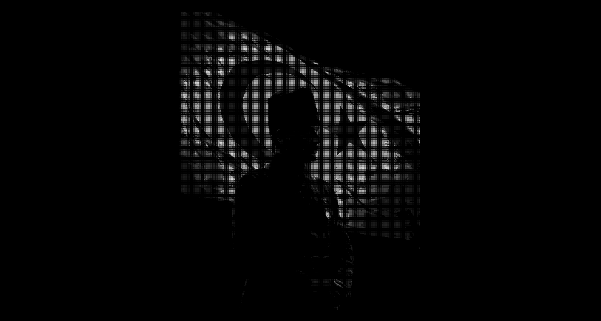

# Parçacıklı Animasyon

Seçtiğiniz bir fotoğrafı on binlerce hücreye bölen ve her hücreyi parlaklığına göre bir karakterle (`.:-=+*#%@`) çizen web animasyonu. Dağınık karakterler ekranda süzülür, soldan sağa doğru toplanıp fotoğrafı oluşturur.

Saf **JavaScript + WebGL2**. Kütüphane yok, derleme yok, kurulum yok.



## Hızlı başlangıç

`index.html` dosyasını tarayıcıda açmak yeterli.

Fotoğraf `photo-data.js` içine gömülü olduğu için dosya `file://` ile açıldığında da çalışır, yerel sunucuya gerek yoktur.

## Nasıl çalışır?

1. Fotoğraf yaklaşık 60.000 hücrelik bir ızgaraya bölünür ve her hücrenin parlaklığı okunur.
2. Her hücre bir parçacık olur. Parlaklığa göre hem karakter (`.` → `@`) hem de gri tonu seçilir. Çok karanlık hücreler çizilmez.
3. Parçacıklar ekrana rastgele saçılır, sonra gecikmeli olarak soldan sağa fotoğraftaki yerlerine toplanır.
4. Tüm hareket GPU'da (vertex shader) hesaplanır. Parçacık başına CPU işi olmadığı için yüz binlerce parçacıkta bile akıcı çalışır.
5. Animasyon oturduktan sonra çizim durur, böylece işlemci ve pil boşuna çalışmaz.

## Kontroller

| Tuş | İşlevi |
| --- | --- |
| Boşluk | Animasyonu baştan oynatır |

Fare ya da dokunma ile etkileşim yoktur, parçacıklar dağıtılamaz.

## Ayarlar

Tüm ayarlar `main.js` dosyasının başındaki `AYAR` nesnesindedir.

| Ayar | Varsayılan | Açıklama |
| --- | --- | --- |
| `PARCACIK` | `60000` | Fotoğrafın bölüneceği yaklaşık hücre sayısı. Daha detay için artırın, 100.000+ de çalışır. |
| `KARAKTERLER` | `.:-=+*#%@` | Koyudan açığa karakter dizisi. |
| `ESIK` | `0.01` | Bu değerden karanlık hücreler çizilmez. |
| `PARLAKLIK` | `1.4` | Genel parlaklık çarpanı. Görüntü koyuysa artırın. |
| `GAMA` | `0.85` | 1'den küçük değerler gölgeleri açar. |
| `KARAKTER_BOYUTU` | `1.25` | Karakterin hücreye oranı. |
| `TARAMA_SURESI` | `2.4` | Fotoğrafın soldan sağa belirme süresi (sn). |
| `BASLANGIC_BEKLEME` | `0.6` | Toplanma başlamadan önceki bekleme (sn). |
| `SONUM` | `2.4` | Toplanırken sönümleme. Büyüdükçe parçacıklar daha hızlı oturur. |
| `SALINIM` | `4.0` | Toplanırken hedefi aşıp geri dönme hızı. |

## Fotoğrafı değiştirmek

Fotoğraf `photo-data.js` dosyasına gömülüdür. Başka bir fotoğraf kullanmak için:

```
pip install pillow
python make-photo-data.py yeni_foto.jpg
```

Komut `photo-data.js` dosyasını yeniden üretir. Siyah arka planlı, yüksek kontrastlı fotoğraflar en iyi sonucu verir. Renkli fotoğraflar siyah beyaza çevrilir.

Python kurmak istemiyorsanız fotoğrafı bir base64 `data:image/jpeg;base64,...` metnine çeviren herhangi bir araçla `PHOTO_DATA` değişkenini kendiniz de güncelleyebilirsiniz.

## Proje yapısı
.
├── index.html           Sayfa iskeleti
├── style.css            Siyah arka plan ve ipucu yazısı
├── main.js              Parçacık sistemi ve WebGL2 çizimi
├── photo-data.js        Fotoğraf (base64 olarak gömülü)
├── photo.jpg            Orijinal fotoğraf (kod kullanmaz, yedek)
├── make-photo-data.py   photo-data.js üretici (isteğe bağlı)
└── README.md


## Tarayıcı desteği

WebGL2 destekleyen güncel Chrome, Edge, Firefox ve Safari sürümlerinde çalışır. Tarayıcı desteklemiyorsa sayfada bunu belirten bir mesaj gösterilir.
"Hareketi azalt" ayarı açık olan cihazlarda animasyon oynatılmaz, fotoğraf doğrudan görünür.

## Fotoğraf kaynağı
 
Fotoğraf bana ait değildir.
 
- Fotoğraf: `photo-data.js` içine gömülü (orijinali `photo.jpg`)
- Kaynak: [A News fotoğraf galerisi](https://www.anews.com.tr/gallery/turkey/mustafa-kemal-ataturk-remembering-the-founder-of-the-turkish-republic-86-years-after-his-death-1731219139/35) (galeri kredisi: "Agencies and A News / Turkey")
- Fotoğrafçı / hak sahibi: Kaynak sayfada belirtilmemiş
- Lisans: Kaynak sayfada belirtilmemiş. Bu fotoğraf için bir kullanım izni iddia edilmemektedir.
- Yapılan değişiklik: Fotoğraf siyah beyaza çevrildi, en fazla 720×900 pikselle küçültüldü ve karakterlerle yeniden çizildi.
Fotoğrafın hak sahibiyseniz ve kaldırılmasını isterseniz, bu repoda bir issue açın. Fotoğraf hemen kaldırılacaktır.
 
## Lisans
 
- Kod: [MIT](LICENSE.txt), © 2026 Naz Aydemir.
- Fotoğraf: MIT kapsamında değildir. Hakları kendi sahibine aittir (yukarıya bakın).
